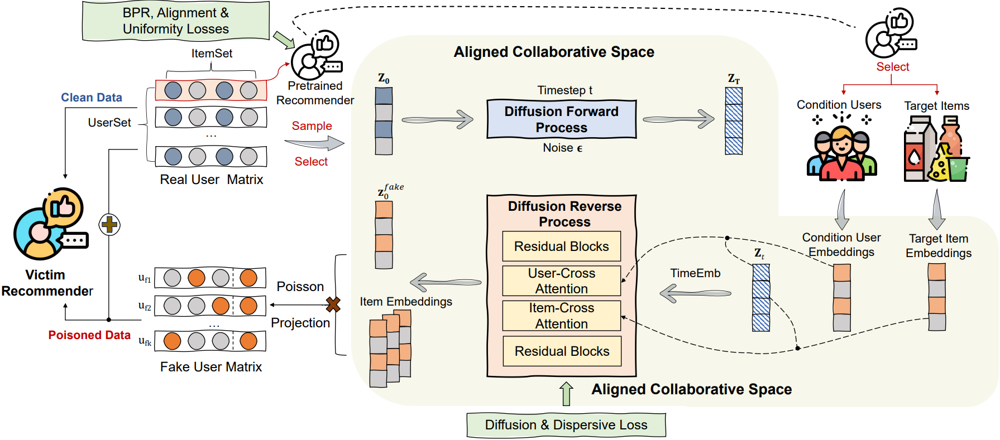

# Dispersive Latent Diffusion for Stealthy Shilling Attacks (DLDA)

Recommender systems (RSs) are vulnerable to shilling attacks because their reliance on user-generated interactions allows adversaries to manipulate item rankings by injecting fake profiles. Existing attacks, however, struggle to jointly achieve effective target promotion, behavioral realism, and low injection cost, due to the tension between concentrating signals around target items and maintaining alignment with genuine users.

We propose the Dispersive Latent Diffusion Attack (DLDA), a gray-box framework that generates target-oriented profiles in a collaborative latent space learned from partial interactions, without access to the victim model's architecture, parameters, gradients, or outputs. DLDA employs conditional latent diffusion with user- and item-side guidance for precise target promotion. Dispersive regularization prevents profile collapse and promotes behavioral diversity, while a Poisson-based projection produces sparse profiles with realistic activity levels. Experiments on three datasets and seven representative recommenders show that DLDA achieves strong target promotion across heterogeneous architectures, better distributional alignment, and substantially lower injection cost, while causing limited or comparable global performance changes. These results highlight the vulnerability of modern RSs to distribution-aware attacks and motivate more robust defenses.



## Requirements
```plaintext
pandas==1.3.5
numba==0.60.0
numpy==1.24.2
scipy==1.13.1
torch==2.1.0
```

## DLDA Quick Start
### 1 Project Structure

```text
DLDA/
├─ main.py                     # experiment entry
├─ ARLib.py                    # training/attack orchestration
├─ conf/
│  ├─ recommend_parser.py      # recommender args
│  └─ attack_parser.py         # attack args
├─ recommender/
   ├─ GMF.py
│  ├─ LightGCN.py
│  ├─ SimGCL.py
│  ├─ NGCF.py
│  ├─ EGCF.py
│  └─ LightCCF.py
├─ attack/
│  ├─ Black/
│  │  ├─ RandomAttack.py
│  │  └─ BandwagonAttack.py
│  ├─ Gray/
│  │  ├─ DLDA.py
│  │  ├─ AUSH.py
│  │  ├─ GSPAttack.py
│  │  └─ ToDA.py
│  └─ White/
│     └─ CLeaR.py
├─ util/
│  ├─ DataLoader.py
│  ├─ metrics.py
│  └─ ...
└─ data/
   └─ clean/
      └─ douban/
         ├─ train.txt
         ├─ val.txt
         ├─ test.txt
         └─ targetItem_unpopular_5.txt
```
## 2 Run
### 2.1 One-command default run (DLDA)

```bash
python main.py
```

Default now maps to:
- dataset: `douban`
- recommender: `LightGCN`
- attack: `Gray/DLDA`


### 2.2 Explicit DLDA run

```bash
python main.py --dataset douban --model_name LightGCN --attackCategory Gray --attackModelName DLDA --gpu_id 0
```

## 3. Outputs

- Saved recommender checkpoints: `./modelsaved/<ModelName>/...`
- Poisoned datasets (generated by attack): `./data/poison/<attack_name...>/<round>/`
