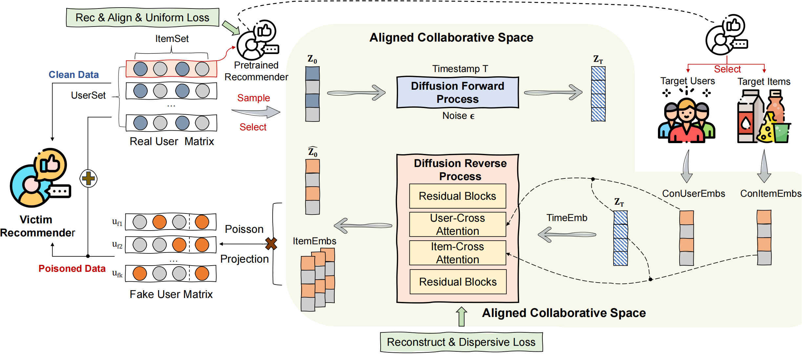

# Dispersive Latent Diffusion for Stealthy Shilling Attacks (DLDA)

Recommender systems (RSs) are susceptible to shilling attacks due to their reliance on user-generated interactions, where adversaries inject fake users to manipulate item rankings. 
Although extensively studied, existing attack methods struggle to simultaneously achieve three key objectives: strong target promotion, realistic behavior for stealth, and low injection cost.

To address this, we propose DLDA, a diffusion-based framework that generates both effective and stealthy fake users. DLDA operates in a pre-aligned collaborative embedding space and leverages conditional latent diffusion with user- and item-side guidance to achieve precise target promotion while preserving natural interaction patterns. To further improve realism, we introduce a dispersive regularization that encourages diverse behaviors and avoids unnatural clustering. In addition, a Poisson-based interaction modeling strategy enables realistic user activity with fewer injected interactions.
Experiments on three real-world datasets and five representative RS models show that DLDA consistently achieves stronger target promotion while remaining harder to detect, with reduced injection cost. These results reveal increased vulnerability of modern RSs and highlight the need for more robust defenses.



## Requirements
```plaintext
pandas==1.3.5
numba==0.60.0
numpy==1.24.2
scipy==1.13.1
torch==2.1.0

## DLDA Quick Start
### 1 Project Structure

```text
DLDA/
├─ main.py                     # experiment entry
├─ ARLib.py                    # training/attack orchestration
├─ conf/
│  ├─ recommend_parser.py      # recommender args
│  └─ attack_parser.py         # attack args
├─ recommender/
   ├─ GMF.py
│  ├─ LightGCN.py
│  ├─ SimGCL.py
│  ├─ NGCF.py
│  ├─ EGCF.py
│  └─ LightCCF.py
├─ attack/
│  ├─ Black/
│  │  ├─ RandomAttack.py
│  │  └─ BandwagonAttack.py
│  ├─ Gray/
│  │  ├─ DLDA.py
│  │  ├─ AUSH.py
│  │  ├─ GSPAttack.py
│  │  └─ ToDA.py
│  └─ White/
│     └─ CLeaR.py
├─ util/
│  ├─ DataLoader.py
│  ├─ metrics.py
│  └─ ...
└─ data/
   └─ clean/
      └─ douban/
         ├─ train.txt
         ├─ val.txt
         ├─ test.txt
         └─ targetItem_unpopular_5.txt
```
### 2 Run
### 2.1 One-command default run (DLDA)

```bash
python main.py
```

Default now maps to:
- dataset: `douban`
- recommender: `LightGCN`
- attack: `Gray/DLDA`


### 2.2 Explicit DLDA run

```bash
python main.py --dataset douban --model_name LightGCN --attackCategory Gray --attackModelName DLDA --gpu_id 0
```

## 3. Outputs

- Logs: `./log/*.log`
- Saved recommender checkpoints: `./modelsaved/<ModelName>/...`
- Poisoned datasets (generated by attack): `./data/poison/<attack_name...>/<round>/`
